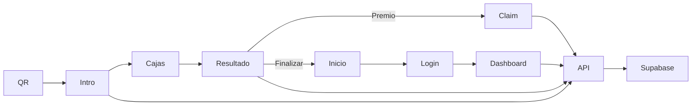

# ChocoPremio

Aplicación web de promociones para varios comercios. El inicio explica la experiencia; cada comercio tiene una ruta de juego y acceso privado a sus estadísticas.



El servidor determina los premios con las probabilidades existentes. Claim recupera el resultado guardado; «Mostrar en caja» es un indicador local, no un canje confirmado. El dashboard permite consultar campañas y estadísticas; no incluye edición de campañas o premios.

## Tecnologías y estructura

- Next.js 16.4.6, React 19 y TypeScript: páginas, navegación y API ejecutada con Node.js.
- Tailwind, CSS Modules y `app/globals.css`: diseño específico y bases compartidas.
- Framer Motion y Recharts: animaciones y gráficos del dashboard. El inicio y el juego usan CSS para sus animaciones.
- Supabase: datos y funciones SQL existentes; el cliente con privilegios solo está disponible en servidor.
- ESLint y TypeScript: revisión del código y comprobación de tipos.

`app/components/ui` contiene controles y marca compartidos. `lib/client` reúne solicitudes y almacenamiento. `lib/game`, `lib/dashboard`, `lib/security` y `lib/server` separan tipos, premios, autenticación y acceso a datos.

## Ejecutar

Utiliza Node.js compatible con Next.js y las credenciales locales del responsable del proyecto. `.env.example` documenta los nombres sin claves reales.

```powershell
npm ci
npm run dev
```

Abre `http://localhost:3000`. Si ya había un servidor iniciado antes de actualizar dependencias, detenlo con `Ctrl+C` y vuelve a iniciarlo. En PowerShell, utiliza `npm.cmd` si la política local bloquea `npm.ps1`.

```powershell
npm run lint -- --max-warnings=0
npm run typecheck
npm run build
npm run start
```

`.next` y `node_modules` son carpetas locales generadas; no forman parte del código fuente.
